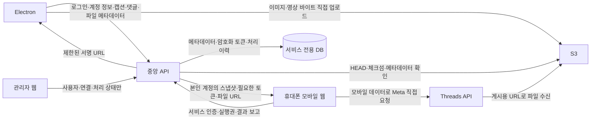

# 모바일 직접 게시 전환 설계

확정일: 2026-10-18. 인증 스택·오프라인 정책 변경 및 계정 중지·재개·이관 폐기: 2026-10-19. 이 문서는 사용자와 확정한 업무 규칙과 후속 구현 계약이다.

**개발 순서는 관리자/API·DB → Electron·S3 → 최소 모바일 연결 → 모바일 완성·통합 검증이다.** 관리자/API·DB 기반과 실제 개발 DB를 사용하는 관리자·직원 로그인을 확인한 뒤, Electron 다중 계정 등록·암호화 토큰 동기화와 게시본 전송 UI·불변 스냅샷 API·PC→S3 전송 코드를 구현했다. 현재는 Electron·S3 연결 단계이며 실제 S3 환경설정·실전송, 모바일 서비스·실제 게시·AWS 배포는 후속 검증 대상이다. 최신 구현 범위는 [전송 계약](mobile-publication-delivery.md)을 따른다. 2026-10-19 신규 프로젝트 경로는 `/Users/xofl/IdeaProjects/threads-admin-api`로 확정했다. 개발·운영은 사용자 확인 기준 PostgreSQL 11.22-rds.20250508(1 GB RAM, 1 vCPU, 40 GB SSD)이고 전용 DB·사용자를 각각 분리한다. `local-video-manager-service`의 Next.js 16.3.0·Drizzle ORM 0.45.2/Kit 0.31.10·Better Auth 1.6.27과 `local-video-manager`의 Electron 인증 흐름을 참고한다. 두 프로젝트와 S3 참조용 `marketo-sync`는 절대 수정하지 않는다. 이전 Prisma/Fastify 이력은 보존하며 현재 실행에 사용하지 않는다. Lambda는 사용하지 않는다.

기존 `validation/mobile-direct/`는 격리 검증 도구로 보존한다. 모의 테스트 38개와 로컬 브라우저 검증을 완료했으며 상세 범위는 [검증 기록](../validation/mobile-direct/verification.md)을 따른다. **실제 Android 휴대폰·모바일 데이터·정상 사용자 토큰의 인증·갱신·게시와 HTTPS 운영 배포는 미검증이다.** 이 실기 검증은 최소 모바일 연결 단계에서 수행하며 관리자/API·DB와 Electron·S3 개발 전체의 선행 차단 조건으로 두지 않는다. 실제 기기 검증 결과 없이 모바일 게시 가능·운영 준비 완료로 보고하지 않는다.

기존 실행과 이력은 [등록 계약](phase-2-registration.md), [기존 API 계약](phase-3-threads-api.md), [삭제 계약](media-deletion.md), [DB 백업·복원 계약](database-maintenance.md)을 따른다. 아래 변경은 새 흐름을 구현·전환할 때 적용한다. 기존 API 계약의 데스크톱 Meta 호출·통계 일정·임시 파일서버 경로를 새 흐름에 이어 붙이지 않는다.

## 1. 확정한 운영 규칙

| 항목 | 결정 |
| --- | --- |
| 서비스 로그인 | 관리자가 ID·비밀번호를 발급한다. 이메일·회원가입·이메일 복구 흐름은 만들지 않는다. |
| 관리자 열람 | 사용자, Threads 계정 연결, 휴대폰 연결, 처리 상태만 관리한다. 캡션·댓글·미디어는 화면과 API 모두에서 열람하지 못한다. |
| 원글과 댓글 | 모바일에서 별도의 버튼으로 실행한다. 원글 성공으로 댓글을 자동 게시하지 않는다. 댓글은 기존 범위의 텍스트·링크 한 개다. |
| 전송 대상 | 데스크톱에서 본인이 소유한 Threads 계정 한 개로 전송한다. 등록순으로 가장 오래된 계정을 기본 선택하고 다른 계정으로 변경할 수 있다. 전송 가능한 계정이 없으면 버튼을 비활성화한다. 여러 계정 일괄 전송은 제공하지 않는다. |
| 게시 기한 | 서버가 전송 완료를 확정한 시각부터 7일이다. 원글 게시 성공 후 기한 표시를 없앤다. 사용자가 설정하는 S3 전용 prefix의 7일 Lifecycle과 구분한다. 대기 중 파일도 Lifecycle 삭제 대상이다. |
| 로컬 등록 삭제 | 같은 로컬 글에서 전송된 원글 미시작 대기물을 서버가 취소한 것을 확인한 뒤 로컬 삭제한다. 원글이 이미 시작·완료·결과 불명이면 중앙 스냅샷 전체를 자동 취소하지 않으며 별도 댓글 대기도 보존한다. |
| 모바일 완료 목록 | 전환 후 새 모바일 흐름에서 게시한 이력만 표시한다. 과거 데스크톱 게시·댓글·통계 이력은 로컬에 보존한다. |
| 퇴사·계정 관리 | 관리자에 의한 서비스 사용자 중지는 자료·이력을 보존한다. 담당자의 개별 Threads 계정 관리에는 삭제만 제공한다. **계정별 중지·재개·직원 간 이관은 모두 폐기했다.** 삭제 후 새 장기 토큰으로 재연결할 수 있으며 휴대폰은 다시 연결한다. [계정 관리 계약](account-management-lifecycle.md)을 따른다. |
| 오프라인 | 정상 로그인 이력이 있어도 인터넷/서비스 확인 실패 시 자료 열람·편집을 포함한 앱 사용을 차단한다. 재연결 뒤 권한을 재검사하며 기존 자료·미완료 작업은 삭제하지 않는다. |
| 도입 | 소수 사용자·계정부터 전환한 뒤 확대한다. |
| 기존 토큰 | 유효한 토큰은 유지한다. 모든 관련 PC의 업데이트와 구버전 사용 중단을 확인한다. 버전 API만으로 구버전의 직접 Meta 요청을 막았다고 간주하지 않는다. |

추가로 다음 결정을 유지한다.

- 직원 한 명은 자신의 Facebook 개발자 로그인 한 개를 사용하고, 운영하는 Threads 계정 수만큼 Meta 앱을 구분해 관리한다. 서비스가 Facebook 비밀번호를 받지는 않는다.
- 각 연결에는 Meta 앱 이름·Threads 계정 이름·사용자가 수동 발급한 장기 사용자 토큰을 순서대로 등록한다. 숫자 App ID는 필수 입력이 아니며 앱 이름은 표시용이다. 동일한 이름이 여러 개 있어도 내부 연결 ID로 구분한다. App Secret을 Electron·모바일 웹에 입력·포함하지 않는다. 클라이언트에서 단기 토큰을 장기 토큰으로 교환하는 기능은 범위에 넣지 않는다.
- Threads 계정의 중복 소유 등록을 허용하지 않는다. 앱별 ID 범위가 다를 수 있다는 전제에서 실제 확인 결과 없이 사용자명 또는 다른 앱의 ID를 동일 계정 판정에 사용하지 않는다.
- 휴대폰 하나는 계정 하나에 연결한다. 모바일 첫 접속에서 본인 계정을 선택한 뒤 고정하고, 일반 기기 교체는 관리자가 기존 연결을 해제한 뒤 다시 등록한다. 담당자가 본인 계정 연결을 삭제할 때는 해당 삭제 과정에서 휴대폰 연결을 해제한다.
- 휴대폰에서는 Wi-Fi를 끄고 모바일 데이터를 사용한다. 모든 Meta 계정 검증·토큰 갱신·컨테이너 생성·게시·댓글·상태 조회·결과 복구는 이 휴대폰의 브라우저에서 직접 요청한다.
- 모바일은 전송된 내용을 확인하고 게시하는 화면이다. 캡션·댓글·미디어 순서를 수정하지 않는다. 원글 게시 시작 전에는 데스크톱에서 회수한 뒤 수정·재전송한다.
- 회사 전체의 동일 콘텐츠 검사나 중복 콘텐츠 자동 삭제는 만들지 않는다. 같은 요청의 반복 실행과 같은 게시 시도의 중복 전송을 막는 보호는 유지한다.

## 2. 세 프로젝트와 요청 경계

| 프로젝트 | 책임 | 실행하지 않는 작업 |
| --- | --- | --- |
| 기존 Electron 앱 | 수집 결과 읽기, 다운로드·편집·직접 작성·등록·댓글 준비, 서비스 로그인, 다중 계정 정보·토큰 등록, S3 직접 전송, 대기물 회수, 새 처리 상태 표시 | 새 흐름의 모든 Meta API 호출, 서버 DB 직접 접속, AWS 장기 키 보관 |
| 신규 관리자 웹 + 중앙 API | ID·비밀번호 발급, 권한·소유권, 계정/휴대폰 연결, 토큰 암호화, 전송 스냅샷·상태·이력, S3 서명 URL·업로드 완료 검증 | Meta API 대리 호출, 미디어 바이트 중계, 관리자에게 본문·댓글·미디어 제공 |
| 신규 모바일 웹 | 본인 계정 연결, 대기물 보기, Meta 직접 계정 검증·토큰 갱신·원글·댓글 게시·상태 확인·복구, 새 흐름의 이력 보기 | S3 업로드 중계, 데스크톱 초안 수정, 인프라 비밀 저장, 서버를 경유한 Meta 대체 호출 |

기존 수집 플러그인·Excel 원본·다운로드 실행기는 변경 대상이 아니다. 플러그인은 수집 완료까지, Electron은 로컬 다운로드·관리·등록까지의 책임을 유지한다.

서버의 S3 내부 복사 요청은 허용한다. 파일 바이트가 Electron이나 API 서버로 되돌아오는 복사·변환·프록시는 허용하지 않는다. 서버의 업로드 확인도 HEAD·체크섬·메타데이터로 한정한다. Meta 직접 호출이 실패하면 오류를 보여주며 Electron·중앙 API·기존 파일서버를 통한 우회 경로로 바꾸지 않는다.

## 3. 인증, 소유권, 비밀 저장

### 서비스 로그인과 권한

Better Auth 쿠키 세션(관리자 웹)과 서명된 Bearer 세션(Electron)을 사용한다. Electron main이 로그인·세션·서버 접근 확인을 담당하고 safeStorage로 보호하며 renderer에는 토큰을 전달하지 않는다. 로그인 ID의 내부 email 매핑은 인증 식별 수단이며 이메일 발송·공개 회원가입은 제공하지 않는다. 최초/주기/작업 전 권한 확인에 실패하면 앱 전체를 잠근다. 인터넷 복구만으로 바로 작업하지 않고 세션·사용자 상태를 다시 확인하며 자료·미완료 작업은 보존한다.

중앙 API가 모든 요청에서 사용자 활성 상태, 세션, 계정 소유권, 휴대폰 연결, 대상 전송물 접근권을 다시 확인한다. 클라이언트가 보내는 사용자 ID·계정 ID·S3 key·업로드 ID만 믿지 않는다. 관리자는 별도 권한으로 연결과 상태를 관리하며 사용자 역할로 가장해 콘텐츠를 여는 기능은 제공하지 않는다.

관리자 응답에는 처리 단계·시각·오류 코드·참조 ID 등 운영에 필요한 정보만 넣는다. 본문·댓글·미디어·썸네일·다운로드 URL·서명 URL·토큰은 관리자 응답과 처리 로그에서 제외한다. 원격 오류 본문에 이런 값이 섞여 있으면 저장·표시 전에 제거한다. 서버가 콘텐츠를 저장·전달한다는 사실과 관리자가 앱에서 그 내용을 읽을 권한이 있다는 것은 별개다.

비활성화 시 신규 로그인·서버 전송·토큰 제공·실행권 발급을 막고 기존 자료를 보존한다. 이미 휴대폰에 전달된 토큰과 이미 전송된 Meta 요청을 서버의 사용자 중지만으로 취소할 수 있다고 주장하지 않는다. 진행 중·결과 불명 이력을 지우거나 다른 직원에게 넘기지 않는다.

### 서버에만 두는 비밀

- DB 접속 암호, AWS 장기 자격증명, 토큰 암호화 마스터 키는 서버 런타임의 비밀 설정에만 둔다. 지원하는 배포 환경이면 서버 역할 기반 AWS 권한을 사용한다.
- 공개 저장소·Electron 배포물·모바일 번들·소스맵·분석 이벤트·빌드 로그에 비밀을 넣지 않는다. GitHub Secrets에서 읽었더라도 클라이언트 번들에 주입하면 비밀 보호가 아니다.
- Electron은 서비스 로그인 세션과 본인이 등록한 Meta 사용자 토큰을 OS 보안 저장소로 보호한다. AWS 키나 DB 암호를 사용자에게 배포하지 않는다.
- 중앙 DB의 Meta 토큰은 별도의 서버 키로 인증 암호화하고 `keyVersion`을 기록한다. 암호화 키를 같은 DB 테이블이나 DB 백업에 함께 넣지 않는다.
- 로컬 OS 암호문을 서버에서 쓸 수 있는 토큰으로 복사하지 않는다. 승인된 등록 흐름에서 HTTPS로 전달한 토큰을 서버가 별도로 암호화한다.
- 휴대폰의 Meta 직접 요청에는 실제 사용자 토큰이 필요하다. 계정별 권한 확인 후 전달하여 실행 중 사용하며, 토큰 입력 UI가 없다는 사실을 브라우저에 토큰이 전혀 전달되지 않는다는 뜻으로 설명하지 않는다. 토큰·서명 URL을 영구 브라우저 저장소·서비스 워커 캐시에 보관하지 않는다.

### 토큰 등록·검증·갱신

1. Electron에서 본인의 Meta 앱 이름·Threads 계정 이름·장기 토큰을 입력한다. 로컬 암호화 저장과 중앙 암호화 저장의 성공 여부를 구분한다. 전송 실패를 중앙 등록 성공으로 표시하지 않는다.
2. 중앙에서는 검증 대기인 연결 후보로 저장한다. 이 단계의 Electron과 중앙 API는 Meta에 요청하지 않는다.
3. 고정된 휴대폰이 해당 후보를 받아 Meta에 직접 계정 확인을 요청하고 결과를 중앙에 보고한다. `/me`의 `id`·`username`과 기대 계정을 비교하고, `debug_token`의 `user_id`·`is_valid`·`expires_at`을 확인한다. 두 응답의 사용자 ID가 일치하고 유효한 토큰인지 확인되기 전에는 게시를 허용하지 않는다.
4. 계정이 다르면 기존 연결과 대기물을 자동으로 새 계정으로 바꾸지 않는다. 연결 오류를 표시하고 해당 토큰을 게시에 사용하지 않는다.
5. 갱신도 휴대폰에서 직접 수행한다. 중앙은 결과를 `expectedCredentialRevision`과 비교해 반영하며, 다른 PC의 교체나 다른 휴대폰의 오래된 응답으로 최신 토큰을 덮어쓰지 않는다.
6. Electron은 중앙의 최신 토큰 revision을 확인해 로컬 암호화 사본을 동기화한다. 오프라인 사본은 최신이라고 가정하지 않으며, 온라인 복귀 시 오래된 토큰을 자동 업로드하지 않는다.
7. 만료·갱신 불가이면 사용자가 장기 토큰을 다시 발급해 PC에서 등록한다. App Secret 입력이나 서버 토큰 교환을 복구 수단으로 추가하지 않는다.

토큰 상태는 `pending_validation`, `usable`, `refresh_required`, `reconnect_required`, `disabled`로 구분한다. 키 교체 버전과 토큰 내용 revision은 다른 값이다. 갱신 응답을 받지 못한 상태나 계정 불일치를 정상 토큰으로 덮어쓰지 않는다.

### Electron 다중 계정 동기화 구현 — 2026-10-19

상단 메뉴의 독립 계정 관리 화면에서 Meta 앱 이름·Threads 계정 이름·수동 장기 토큰을 순서대로 등록한다. 이름은 한글·영문을 허용하고 숫자 App ID는 입력받지 않는다. 서버 등록 상태와 휴대폰 검증 보고 상태를 별도로 표시한다. 현재 서버의 `validationStatus`는 `pending_validation`·`reported_valid`·`invalid`이며, 위 운영 토큰 상태 전체를 이미 구현했다는 뜻은 아니다. 서버가 보고받은 만료 시각과 App ID 확인 여부도 검증 출처를 구분해 표시한다.

- `managed-threads.enc`에 OS 보안 저장소로 암호화한 사본을 저장한다. 서비스 주소·직원 ID별로 분리하고 파일 권한은 0600이다. 기존 단일 계정 토큰·게시 이력 파일은 보존하며 자동 이전·삭제하지 않는다.
- 등록·교체 입력은 원격 요청 전에 로컬에 암호화 저장한다. 원격 오류나 응답 유실은 보류 상태로 남기고, 조회·재접속은 서버 정보를 내려받기만 한다. 원격 재전송에는 사용자의 명시적 재시도가 필요하다.
- 등록 전에 만든 `registrationId`를 암호화 보관하고 같은 ID로만 재시도한다. 서버는 사용자별 같은 등록 ID를 하나의 연결로 처리하며 이름이 같다는 이유로 계정을 합치지 않는다. 등록 응답이 유실되면 해당 ID의 계정·토큰을 비교해 반영 여부를 확인한다. 교체는 revision과 토큰을 함께 비교한다. 확인된 성공을 재전송하지 않으며 다른 토큰이나 최신 revision과 충돌하면 보류를 유지한다.
- 휴대폰이 갱신한 최신 토큰은 서버에서 받아 로컬 암호화 사본을 갱신한다. 보류 입력은 최신 토큰을 자동으로 덮어쓰지 않는다. 사용자가 보류를 버려도 서버 토큰은 삭제하지 않는다.
- renderer에는 계정 메타데이터만 반환한다. 토큰·암호문·인증 Bearer를 조회하는 IPC나 임의 URL 요청 IPC를 만들지 않는다. 로그아웃·사용자 변경 전의 요청은 새 사용자에게 실행되거나 결과가 표시되지 않도록 차단한다.
- 서비스 연결 실패 시 계정 화면도 전체 앱 잠금 정책을 따른다. 손상된 암호화 파일을 초기화하지 않으며 저장소 사용 불가 시 평문으로 대체하지 않는다. 계정 작업 중에는 일반 앱 종료·업데이트 재시작을 보류한다.

Meta 직접 검증·갱신·게시를 실행하는 데스크톱 경로는 추가하지 않았다. 본인 계정 하나로 게시본을 보내는 기능과 S3 직접 업로드 코드는 구현했으며 실제 S3 설정·업로드는 별도로 검증한다.

**앱 이름과 Meta의 실제 App ID는 구분한다.** 숫자 App ID는 필수 입력에서 제거한다. 휴대폰의 유효한 검증·갱신 보고에 실제 `app_id`가 있으면 별도 필드에 기록하고, 이미 기록된 ID와 다르면 차단한다. 응답에 없으면 자동으로 알아냈다고 간주하지 않는다. 입력한 앱 이름이나 `application` 문자열만으로 Meta 앱이 검증됐다고 표시하지 않는다. 기존 숫자 App ID는 이전 연결의 확인 자료로 보존한다.

**앱별 계정 ID는 최소 모바일 연결 단계에서 확인한다.** App ID가 다른 장기 토큰에서 동일 Threads 계정이 어떤 ID로 반환되는지, App Secret 없이 필요한 앱·계정 연결을 확인할 수 있는지 실제 모바일 응답과 공식 계약으로 확인한다. 그 전에도 관리자/API·DB 기반과 Electron 연동은 구현하되, 검증 대기 계정을 확인 완료로 취급하지 않는다. `(appId, threadsUserId)`를 연결 식별 자료로 보존하되 이것만으로 앱을 가로지르는 계정 중복 금지가 완성됐다고 선언하지 않는다. 확인 전에는 username 문자열이나 출처가 다른 ID로 자동 병합하지 않는다. 검증용 웹의 사용자 앱 연결 확인을 운영 서비스의 앱 간 계정 식별 실증 완료로 대체하지 않는다.

## 4. 휴대폰 연결과 모바일 데이터

모바일 서비스 로그인 후 본인 계정 한 개를 선택하여 서버의 브라우저 등록과 연결한다. 이후 일반 화면에는 계정 전환을 두지 않는다. 일반 기기 교체 요청은 관리자 해제 후 새 등록으로 처리하고 이전 세션·실행권의 상태를 확인한다. 담당자의 계정 삭제에서는 해당 삭제 트랜잭션으로 연결·세션을 해제한다. 삭제 후 재등록 시에는 기존 연결을 복원하지 않고 휴대폰을 새로 연결한다. 진행 중·결과 불명 게시가 있다고 해서 새 휴대폰에서 같은 글을 자동 게시하지 않는다.

브라우저 저장과 서버 세션은 논리적 연결 수단이다. 브라우저 초기화·다른 브라우저·프로필까지 물리적으로 같은 휴대폰임을 증명하는 장치가 아니다. 관리자 해제 정책과 서버의 중복 활성 연결 검사로 운영한다.

사용자는 Wi-Fi를 끄고 모바일 데이터를 켠다. 모바일 웹은 게시 전 안내와 확인을 제공한다. 브라우저의 네트워크 정보만으로 모바일 데이터 경로를 항상 강제·증명할 수 있다고 표현하지 않는다. 실제 Android 검증에서는 사용자가 연결 설정과 직접 요청 경로를 확인한다. 휴대폰을 사용한다는 이유만으로 Meta의 계정 제한 가능성이 없어지거나 줄어든다고 보장하지 않는다.

Meta 요청의 `User-Agent`나 기기 식별 정보를 고정 문자열로 덮어쓰지 않고 브라우저 기본 동작을 사용한다. 기기별로 값을 무작위 생성하거나 Threads 앱의 기기 정보인 것처럼 위장하지 않는다. 같은 브라우저 버전의 정상 기기에서도 같은 User-Agent가 나타날 수 있으므로 문자열 일치만으로 오작동·차단을 판단하지 않는다. 이 서비스가 MAC 주소나 설치된 Threads 앱의 인증 세션을 수집하는 기능은 만들지 않는다. 실제 Android 직접 요청 검증에서 사용자 지정 헤더·기기 값이 추가됐는지도 확인한다.

## 5. 데스크톱의 전송 준비와 S3 직접 업로드

로컬 등록 저장과 중앙 전송은 별도 행동이다. 전송 시점의 본문, 댓글·링크, 선택 미디어와 순서, 로컬 revision, 대상 계정을 한 스냅샷으로 만든다. 기존 수집 계정은 출처이며 게시 대상 Threads 계정과 별도 필드로 관리한다. 직접 작성의 `:local:` 출처도 유지한다.

1. 사용자가 본인 계정 하나를 선택해 **모바일로 보내기**를 실행한다. 기존 준비·형식 검사와 필요한 이미지·영상 변환은 PC에서 수행한다.
2. 중앙 API가 사용자·대상 계정과 전송 요청의 멱등 키를 확인하고 전송 세션·파일 manifest를 만든다. 파일별 예상 크기·체크섬·종류·순서·전용 S3 key를 고정한다.
3. 중앙이 특정 파일에 한정한 짧은 유효기간의 단일 PUT 서명 URL을 반환한다. 임의 bucket/key를 클라이언트가 지정할 수 없다. 현재는 multipart 부분 재개를 제공하지 않으며 명시적 재시도에서 파일 단위로 전송한다.
4. PC가 파일 바이트를 S3에 직접 전송한다. 중앙 API에는 상태·완료 요청만 보낸다. 실패·재개에서도 API 서버로 파일을 중계하지 않는다.
5. 중앙이 HEAD로 S3의 실제 크기·SHA-256·종류와 manifest를 확인한다. ETag를 SHA-256으로 대신하지 않으며 클라이언트가 보낸 완료 문자열만으로 확정하지 않는다.
6. 임시 파일 PUT에는 If-None-Match 조건을 넣고, 확인한 파일을 S3 내부 복사로 별도 게시용 객체에 확정한다. 완료 시도마다 새 목적지 key를 사용해 늦게 끝난 복사가 수락된 파일을 덮어쓰지 못하게 한다. 임시 staging/과 게시용 published/ 경로를 분리한다.
7. 모든 첨부의 확정과 스냅샷 저장이 끝난 뒤 서버 시각의 `sentAt`과 `deadlineAt = sentAt + 7일`을 기록하고 모바일 게시 대기에 넣는다. 일부 파일만 완료된 전송은 모바일 게시 대상으로 노출하지 않는다.

업로드 상태와 Meta 게시 상태를 섞지 않는다. S3 업로드 완료는 Threads 게시 성공이 아니다. HEAD 검증은 객체의 저장 상태·크기·체크섬 확인이며, 실제 파일의 디코딩 가능성과 MIME 내용까지 서버가 검사했다는 뜻이 아니다. 해당 형식 검사는 기존 PC 준비 단계와 실제 Meta 처리 결과로 확인한다.

서명 URL도 유효기간 동안 권한을 가진 값이므로 저장·로그 노출을 제한한다. 재전송 요청은 같은 전송 세션으로 수렴시키며, 같은 파일을 다시 PUT할 수 있다는 사실을 일회성 서명이라고 설명하지 않는다. 회사 전체 콘텐츠 hash/pHash 비교나 타인 자료 자동 삭제는 이 흐름에 추가하지 않는다.

## 6. 전송 후 회수와 수정

모바일은 저장된 스냅샷을 그대로 보여준다. 로컬 초안을 수정하더라도 이미 전송한 본문·댓글·미디어 순서가 자동 변경되지 않는다.

원글 실행이 시작되지 않은 대기물은 PC에서 **회수**할 수 있다. 서버가 실행권 발급과 회수를 원자적으로 판정하여 회수를 확정한 후, 사용자는 로컬에서 수정하고 새 스냅샷을 전송한다. 실행권을 소비하여 원글 작업이 시작된 시점의 `rootStartedAt`은 이후 실패·결과 불명이어도 지우지 않는다. 시작된 스냅샷을 회수 가능한 새 대기물로 되돌리지 않는다.

하나의 로컬 등록 글이 여러 번의 명시적 전송으로 여러 중앙 스냅샷을 가질 수 있으므로 로컬 글 연결과 전송 ID를 별도로 보존한다. 네트워크 재시도는 같은 전송이며, 회수·수정 후 재전송은 새로운 전송이다. 대상은 매번 본인 계정 한 개다.

## 7. 원글·댓글 게시와 결과 불명

### 원글

1. 모바일에서 대상 계정, 본문, 파일 순서, 게시 기한을 확인하고 원글 게시 버튼을 누른다.
2. 중앙 API는 활성 사용자·휴대폰 연결·토큰 revision·스냅샷·기한·모든 첨부를 확인하고 하나의 실행권을 발급한다. 동일 스냅샷의 중복 실행권을 발급하지 않는다.
3. 휴대폰이 실행권을 소비해 `rootStartedAt`과 시도 ID를 기록한 뒤 Meta에 직접 미디어 컨테이너·캐러셀 컨테이너를 만든다. 반환 ID와 진행 상태를 중앙에 기록한다.
4. 휴대폰이 Meta 처리 상태를 직접 조회하고, 실제 publish 요청 전에 중앙에 게시 의도를 기록한다. 중앙 기록에 실패하면 새로운 publish 요청을 보내지 않는다.
5. 휴대폰이 Meta에 직접 publish를 요청하고 성공 ID·시각을 중앙에 보고한다. 원글 성공 후 기한 표시를 없애고 댓글 버튼을 별도로 제공한다.

### 댓글

사용자가 댓글 버튼을 별도로 눌렀을 때만 실행한다. 같은 스냅샷·계정의 성공한 원글 remote ID와 저장된 댓글·링크를 사용한다. 댓글에는 별도 시도 ID·실행권·상태·원격 ID를 기록하며 원글과 동일한 결과 불명 보호를 적용한다.

원글 성공·댓글 실패/결과 불명을 각각 표시한다. 댓글 재시도로 원글을 다시 게시하지 않는다. 원글 성공 후 텍스트 댓글은 원글의 7일 미디어 게시 기한이나 S3 파일 만료에 종속시키지 않는다. 이미 게시한 댓글을 로컬 수정만으로 바꾸거나 자동 재게시하지 않는다.

### 불확실한 응답과 복구

Meta 요청과 중앙 DB 기록은 하나의 트랜잭션이 아니다. 앱 종료·화면 잠금·네트워크 전환·응답 손실·결과 보고 실패가 발생하면 실제 원격 처리와 중앙 기록이 다를 수 있다.

- 요청이 전송되기 전임이 확인된 실패와, 전송 후 성공 여부가 불명확한 경우를 구분한다.
- 결과 불명은 `uncertain`으로 보존하고 자동 재시도하지 않는다. HTTP 오류나 CORS 오류만으로 Meta가 요청을 처리하지 않았다고 단정하지 않는다.
- 시간 경과·실행권 만료·S3 파일 삭제·토큰 교체·사용자 중지가 결과 불명을 실패나 신규 대기로 바꾸지 않는다.
- 복구 조회도 해당 휴대폰이 Meta에 직접 수행한다. 알려진 컨테이너/게시 ID, 계정, 원글·댓글 관계와 응답을 확인한 뒤 상태를 보고한다. 근거가 부족하면 결과 불명을 유지한다.
- 중앙은 휴대폰이 보고한 결과와 보고 시각·근거 종류를 기록한다. 서버가 Meta에 직접 재검증한 결과인 것처럼 표시하지 않는다.
- 명확한 실패의 재시도는 사용자의 명시적 동작으로만 한다. 이전 성공·미해결 시도, 기한, 미디어, 토큰 상태를 다시 확인하며 원글과 댓글의 재시도를 분리한다.

## 8. 7일 게시 기한과 S3 정리

게시 기한은 중앙의 전송 완료 시각부터 정확히 7일으로 계산한다. 클라이언트 시간·휴대폰 시간대를 근거로 연장하지 않는다. 화면의 카운트다운과 별개로 서버가 신규 원글 실행을 제한한다.

S3의 7일 Lifecycle은 사용자가 전용 prefix에 설정한다. 객체별 생성 시각, UTC 날짜 경계, 비동기 삭제 때문에 `deadlineAt`과 실제 삭제 시각은 같지 않다. 대기 중이라는 이유로 Lifecycle이 유예되지는 않는다. 완료 이력에서도 원글 성공은 S3 보관 연장을 뜻하지 않는다.

다중 첨부는 첫 업로드와 마지막 업로드의 시각이 다를 수 있다. 최종 객체 확정 과정에서 각 객체의 Lifecycle 기준 시각을 확인하고, 전송 완료 후 7일을 제공하는 설계와 충돌하지 않도록 최종 객체 생성·버전·복사 방식을 검증한다. 오래된 임시 객체나 다른 전송의 파일을 새 대기물에 그대로 참조하지 않는다. 운영 Lifecycle 설정과 날짜 경계 검증이 끝나기 전에는 7일 동안 파일이 항상 남아 있다고 보장하지 않는다.

- 원글 미시작 상태에서 기한이 지났거나 첨부가 사라지면 게시할 수 없는 만료 상태로 처리한다. 파일이 남아 있어도 기한이 지나면 새 원글 게시를 시작하지 않는다.
- 기한 안이라도 첨부 누락·접근 불가를 확인하면 원글 게시를 시작하지 않는다. 일부 첨부를 빼고 자동 게시하지 않는다.
- 기한 직전에 시작할 때 Meta의 파일 수신·영상 처리에 필요한 URL 유효기간과 남은 파일 수명을 확인한다. 충분한 수신 시간을 확보하지 못하면 시작을 허용하지 않는다.
- 이미 시작한 시도는 기한 도달로 성공/실패/결과 불명 상태를 지우지 않는다. 늦게 확인된 성공도 보존하며 자동 재게시하지 않는다.
- 파일이 만료되어도 중앙의 본문·댓글·메타데이터·원격 ID·처리 이력은 보존한다. 이력 미리보기에는 미디어 만료를 표시하고 자동 복원·재업로드하지 않는다.
- PC 업로드에 사용하는 IP 제한을 Meta GET URL에 그대로 적용하지 않는다. Meta가 파일을 가져오는 경로에는 사용자 쿠키·서비스 로그인·휴대폰 IP가 필요하지 않아야 한다.

기존 버킷을 재사용하고 개발은 `threads/dev/`, 운영은 `threads/prod/`로 분리한다. S3 권한은 신규 서비스의 전용 prefix·필요 동작으로 제한한다. 실제 적용 전 공개 정책, Object Ownership, CORS, 암호화, 버전 관리와 겹치는 Lifecycle 규칙을 확인한다. 비공개 객체와 제한된 presigned GET은 권장 구현안이며 기존 버킷 전체의 정책 변경을 전제로 하지 않는다. 기존 서비스의 파일·정리 prefix·Lambda 경로를 재사용하지 않는다.

## 9. 로컬 등록 삭제와 중앙 대기물

로컬 등록 삭제는 기존의 확인창·revision 검사·수집/등록 독립 삭제·외부 원본 보존·삭제 저널을 유지하면서 다음 중앙 확인을 추가한다.

1. 서버가 같은 `libraryId + postKey`에 연결된 모든 전송 스냅샷을 조회한다.
2. `rootStartedAt`이 없고 아직 원글 게시를 시작하지 않은 대기물만 자동 취소한다. 이미 취소·만료된 항목은 그 상태를 보존한다.
3. 원글이 시작되었거나 성공·결과 불명이면 스냅샷 전체를 자동 취소 대상에서 제외한다. 그 안의 본문·댓글·미디어 참조·이력과 아직 누르지 않은 별도 댓글 대기도 보존한다. 로컬 삭제가 원격 Threads 글이나 댓글을 지우지는 않는다.
4. 중앙의 대기 취소, 모바일 실행권 소비, 같은 로컬 글의 신규 전송 접수가 경합해 잘못된 취소 확인을 만들지 않도록 트랜잭션과 삭제 확인 버전을 사용한다.
5. 서버가 대상별 취소·보존 결과를 확정한 뒤에만 로컬 삭제를 수행한다. 서버 응답 손실 시 같은 삭제 요청 ID로 결과를 재확인하고 성공을 추정하지 않는다.
6. 중앙 취소 후 로컬 삭제가 실패하면 중앙 취소는 유지하고 로컬 삭제 저널로 재시도한다. 새 전송이나 원격 게시를 자동 실행해 되돌리지 않는다.

인터넷/서비스 확인 실패 시 앱 전체 사용을 차단하므로 로컬 전용 글을 포함한 삭제 작업도 시작하지 않는다. 연결 복구 후 중앙 대기물의 취소를 확인하고 기존 삭제 계약을 적용한다. 로컬 DB 복원으로 중앙의 취소·게시 완료·결과 불명 기록을 과거 상태로 되돌리지 않는다.

## 10. 논리 데이터 모델

개발·운영 PostgreSQL 11.22와 전용 DB·사용자 생성 가능 여부는 사용자에게 확인했다. 중앙 프로젝트는 Drizzle ORM 0.45.2·Kit 0.31.10과 Better Auth 인증 스키마를 사용한다. schema 변경 → SQL generate → 검토 → migrate로 관리하며 shadow DB가 없다. 운영에서 db push·reset·자동 초기화를 실행하지 않는다. 기존 로컬 SQLite를 서버 DB로 통째로 옮기지 않으며 기존 서비스의 테이블·migration 이력을 공유하지 않는다. 현재 물리 모델은 Better Auth의 user/session/account/verification 및 인증 제한·감사 테이블과 Threads의 threads_account/account_credential/mobile_binding/threads_audit이다. 이전 Prisma 이력이 DB에 있다면 새 초기 SQL을 섞지 않고 별도 이관을 검토한다. 아래 게시·파일·실행권 모델은 다음 단계의 논리 계약이다.

| 논리 엔터티 | 핵심 정보·제약 |
| --- | --- |
| `users` | 관리자 발급 로그인 ID, 비밀번호 해시, 역할, 활성/중지 상태. 삭제·이관 대신 보존. |
| `sessions` | 사용자·클라이언트 종류·만료·폐기 정보. 서버 권한 검사의 근거. |
| `threads_accounts` | 내부 계정 ID, 담당 사용자, 등록 재시도 ID, 표시용 앱 이름, 선택적인 실제 Meta App ID, Meta 계정 식별 자료, 검증 상태. 출처 수집 계정과 분리. 동일하게 보고된 Threads ID는 UNIQUE로 막지만, 앱마다 ID가 다른 실제 동일 계정까지 식별했다고 보장하지 않는다. |
| `account_credentials` | 암호화 토큰, key version, credential revision, 만료·휴대폰 검증·갱신 시각. 평문 응답은 소유자 휴대폰 실행과 승인된 로컬 동기화에만 제한. |
| `mobile_bindings` | 사용자·고정 계정·브라우저 등록·활성/해제·관리자 조치 이력. |
| `publication_snapshots` | 사용자, 로컬 library/post/revision, 대상 계정 한 개, 본문·댓글·선택 순서의 불변 사본, 전송·기한·취소·원글 시작 시각. |
| `upload_sessions` | 소유자·스냅샷·멱등 키·파일 manifest·multipart 진행·완료 검증. |
| `media_assets` | 소유 스냅샷, 순서, S3 key/version, 크기·종류·체크섬 방식/값, 객체 시각, 확정·만료/삭제 상태. |
| `publication_attempts` | 스냅샷, 원글/댓글 구분, 시도 ID, 실행권·token revision, 단계·컨테이너/자식 ID·원격 ID·부모 ID, 결과 불명과 확인 근거. |
| `audit_events` | 사용자·계정 연결·토큰 revision·휴대폰 해제·상태 변화. 관리자에게 콘텐츠·비밀을 노출하지 않는 운영 기록. |
| `deletion_requests` | 로컬 삭제/회수 요청 ID, 대상과 판정 버전, 취소·보존 결과, 재확인·복구 상태. |

서비스의 멱등 키·고유 제약과 원자적 상태 전이로 정상 클라이언트의 중복 클릭·재전송을 막는다. 동일 콘텐츠의 회사 전체 중복 검사를 이 제약으로 확대하지 않는다. 토큰을 가진 클라이언트의 Meta 호출과 중앙 DB를 완전한 단일 트랜잭션으로 만들 수 없으므로 결과 불명 상태를 모델에서 제거하지 않는다.

주요 상태는 다음처럼 분리한다.

- 파일: `preparing → uploading → verifying → finalized`, 실패·취소 시 정리 상태 별도.
- 스냅샷: `uploading → ready → root_started`; 미시작에서만 `recalled/cancelled/expired` 전이. 시작된 뒤의 결과는 원글·댓글 시도에서 관리.
- 원글/댓글 시도: `preparing → processing → publish_intent → published`, 또는 `failed/uncertain`. 원글 성공과 댓글 대기·실패를 동시에 표현.
- 파일 만료·사용자 중지·토큰 만료는 게시 결과와 독립적인 상태이며 성공·결과 불명을 덮어쓰지 않음.

## 11. 중앙 API 예시

아래 경로는 역할을 설명하기 위한 예시다. 구현된 공개 API 명세가 아니며 모든 변경 요청은 인증·소유권·버전 검사와 멱등성 규칙을 적용한다. 아래 `publication-transfers`는 PC에서 게시본·파일을 보내는 기능이며, 폐기된 직원 간 계정 이관과 무관하다.

| 예시 | 역할 |
| --- | --- |
| `POST /sessions`, `DELETE /sessions/current` | ID·비밀번호 로그인·로그아웃 |
| `POST /accounts`, `PUT /accounts/:id/credential` | 본인 앱 이름·계정 이름·장기 토큰 등록/교체. 고정 등록 ID로 재시도하며 Meta 호출 없음. |
| `POST /mobile-bindings`, 관리자 연결 해제 | 본인 계정 고정·일반 기기 교체 시 관리자 해제. 계정 삭제 시 연결·세션을 함께 폐기 |
| `POST /accounts/:id/validation-results`, `POST /accounts/:id/refresh-results` | 휴대폰의 직접 검증·갱신 결과를 credential revision과 함께 반영 |
| `POST /publication-transfers`, `POST /publication-transfers/:id/upload-urls` | 스냅샷·파일 manifest 생성, 제한된 S3 업로드 권한 발급 |
| `POST /publication-transfers/:id/complete` | HEAD·체크섬 검증과 최종 객체 확정, sentAt/deadlineAt 기록 |
| `GET /mobile/queue`, `GET /mobile/history` | 연결된 본인 계정의 대기물·새 흐름 이력 |
| `POST /snapshots/:id/root-attempts`, `POST /snapshots/:id/reply-attempts` | 별도 실행권·시도 생성. Meta 호출 없음. |
| `POST /attempts/:id/events` | 의도·컨테이너·결과·복구 근거 기록. 상태가 모순되면 거절. |
| `POST /snapshots/:id/recall`, `POST /local-post-deletions` | 원글 미시작 회수와 로컬 삭제 전 모든 관련 대기물 판정 |
| `/admin/users`, `/admin/account-bindings`, `/admin/processing` | 사용자·연결·상태만 제공하는 관리자 전용 응답 |

API에는 이미지·영상 multipart 본문이나 base64 미디어를 받는 경로를 만들지 않는다. 요청 크기를 제한하고 미디어 바이트가 API로 유입되는 실수도 검사한다. 모바일에 제공한 스냅샷·토큰·파일 URL을 관리자 목록 API에서 재사용하지 않는다.

## 12. 기존 기능과 데이터의 전환

### 로컬 기능과 과거 이력

수집·다운로드·편집·직접 작성·로컬 등록·댓글 준비·ZIP·로컬 백업은 유지한다. 인터넷/서비스 확인 실패 시 새 조작은 차단하고 기존 자료·진행 기록은 보존한다. 온라인 복귀가 자동 전송·재다운로드·자동 게시 명령이 되지 않는다.

기존 게시·댓글·결과 불명·통계 이력은 기존 로컬 저장과 컴퓨터 이전 계약으로 보존한다. 중앙으로 일괄 이관하거나 모바일 완료 목록에 합치지 않는다. 새 흐름에서 명시적으로 전송한 스냅샷만 중앙 자료가 된다. 기존 원격 성공을 새 대기물로 오인해 자동 전송하지 않도록 로컬 화면에서 구분한다.

### 데스크톱 Meta 호출과 통계 중단

전환된 Electron은 원글/댓글 게시뿐 아니라 계정 확인, `debug_token`, 토큰 갱신, 처리 상태·복구, permalink 조회 등 모든 Meta 호출 경로를 중단한다. 기존 이력 링크를 여는 보조 기능도 PC에서 Meta를 호출하지 않는지 확인한다. UI만 숨기는 방식으로 끝내지 않고 시작·예약·수동 IPC·백그라운드 경로를 함께 차단한다.

통계는 자동·수동 모두 중단한다. 관련 코드와 과거 값·조회 시각은 보존하되 예약 실행·시작 시 조회·수동 버튼/IPC에서 요청하지 않는다. 중앙과 모바일에 통계를 새로 구현하는 것은 이번 범위가 아니다.

### 유효 토큰·구버전·파일서버

유효한 기존 장기 토큰을 계속 사용한다. 신규 계정 정보의 앱·계정 이름과 실제 토큰 연결을 확인하고 필요한 암호화 형식으로 명시적으로 등록·동기화한다. 기존 토큰이나 암호화 저장 파일을 임의 삭제하지 않는다.

전환 전에 사용자의 모든 관련 PC가 새 버전인지, 기존 게시·갱신·통계 실행이 중단됐는지 확인한다. 구버전은 중앙 API를 거치지 않고 자신이 가진 토큰으로 Meta에 요청할 수 있으므로 서버 버전 검사만으로 차단할 수 없다. 토큰 유지 결정에 따라 운영상 구버전 중단 확인을 배포 조건으로 둔다.

기존 파일서버는 신규 전송 경로에서 사용하지 않는다. 소수 전환과 구버전 중단 확인이 끝난 뒤 종료 범위를 별도로 확정한다. 파일서버 종료가 기존 PC의 텍스트 댓글·토큰 갱신·통계 요청까지 차단하는 수단은 아니다. 현재 관리자/API·DB 기반 구축에서는 파일서버나 사용자 연결코드를 변경하지 않는다.

## 13. 구현 순서와 통과 조건

1. **관리자/API·DB 기반 — 기반 구현 및 개발 DB 로그인 확인.** 새 독립 프로젝트에서 관리자 발급 ID·비밀번호 로그인, 사용자 생성·사용 중지, 역할과 소유권 검사, 본인 계정 연결, 별도 키를 쓰는 토큰 암호화·revision, 기본 DB 모델, 휴대폰의 논리적 연결·관리자 해제 기반을 만든다. 관리자에게 콘텐츠·토큰을 노출하지 않는 응답 계약과 스냅샷·실행권·결과 불명 모델을 정의한다. Next.js·Drizzle·Better Auth 인증과 migration을 PostgreSQL 11.22 로컬 인스턴스에서 검증하며 Electron 로그인도 기존 local-video-manager 방식으로 연결한다. 이 단계에서 S3 실연동, 전체 Electron 게시 전환·모바일 서비스 연결, Meta 실게시, AWS 배포까지 완료했다고 표시하지 않는다.
2. **Electron·S3 연결 — 현재 구현·검증 단계.** 다중 계정 등록·로그인·암호화 토큰 동기화, 한 계정으로 보내기, 스냅샷·회수·삭제 확인·인터넷 단절 시 전체 사용 차단을 연결한다. PC 직접 S3 업로드, HEAD·체크섬 검증, 불변 객체, 7일 기한, Lifecycle·CORS·권한 범위를 시험한다. 모든 데스크톱 Meta/통계 실행 경로를 비활성화하고 로컬 자료·과거 이력·유효 토큰 보존을 확인한다. 실제 S3 설정은 사용자가 적용하고 에이전트는 AWS에 접속하지 않는다.
3. **최소 모바일 연결·실기 검증.** 별도 모바일 웹에서 로그인, 본인 계정 고정, 서버 스냅샷 조회, 권한 있는 토큰 수신, 명시적 원글/댓글 실행과 결과 보고를 우선 연결한다. 이 단계에서 신뢰할 수 있는 HTTPS origin, Android 브라우저, Wi-Fi를 끈 모바일 데이터, 사용자가 선택한 계정의 장기 토큰으로 계정 확인·갱신·대표 원글/댓글 게시·상태 조회의 직접 호출과 CORS를 실기 검증한다. 앱 간 계정 식별과 토큰 연결도 확인한다. 실제 게시 시험은 대상·내용을 확인한 명시 실행으로만 한다. 실패하면 해당 모바일 기능과 운영 전환을 보류하고 서버 대리 호출로 바꾸지 않는다.
4. **모바일 완성·통합 검증.** 조회 전용 스냅샷, 별도 원글/댓글 버튼, 게시 기한·미디어 만료·처리 중 표시, 오류·결과 불명 복구, 새 모바일 이력을 완성한다. 이미지·영상·혼합 캐러셀, 화면 잠금·복귀, 통신 중단, 중복 탭, 토큰 revision, 회수·삭제 경합을 실제 흐름까지 확인한다. 기존 검증 도구의 모의·브라우저 결과를 운영 서비스 통합 또는 Android 실기 결과로 대신하지 않는다.
5. **소수 사용자 전환·확대.** 통합 검증과 모든 관련 PC 업데이트·구버전 중단을 확인한 그룹부터 전환한다. 운영 서버 구축, 실제 Windows 설치·업데이트, 사용자 자료 보존, Android 직접 게시 결과를 각각 기록하고 확대한다. 파일서버 종료는 별도 확정한다.

`validation/mobile-direct/`의 모의 테스트 38개·로컬 브라우저 검증 결과와 진단·복구 도구는 보존한다. 실제 Android 검증을 먼저 끝내야만 1·2단계 개발을 시작할 수 있다는 이전 순서는 적용하지 않는다. 실기 검증은 3단계의 통과 조건이며, 모바일 게시 운영 전환은 4단계의 통합 검증까지 마친 뒤 진행한다.

신규 관리자/API 프로젝트는 `/Users/xofl/IdeaProjects/threads-admin-api`다. 2026-10-19 사용자 결정에 따라 Next.js·Drizzle·Better Auth 기반과 Electron 인증을 전환했다. 새 서비스 단위 검사 41개, 격리 PostgreSQL 11.22 HTTP assertion 69개와 제약 assertion 8개, Next 빌드·Docker linux/amd64 실행이 통과했다. 이후 사용자 요청에 따라 DB CA 설정을 생략하고 외부 DB의 TLS 암호화를 유지하도록 변경했으며 연결 설정 검사 6개를 포함한 회귀 검사 47개가 통과했다. Electron은 46개 테스트 파일/1,241개 테스트와 타입·린트가 통과했고, 격리된 Mac 앱에서 로그인·초기 비밀번호 변경·서버 중단 잠금·복구·OS 암호화 세션의 재시작 복원을 확인했다. 이전 Prisma의 모의46개/격리 DB11개 검증은 과거 기록으로 보존하며 새 스택의 통과 증거로 대신하지 않는다. 최신 검사 결과는 신규 프로젝트 `docs/verification.md`와 Electron 검사 결과를 따른다.

후속으로 사용자가 명시적으로 요청한 전용 개발 DB 확인·적용 범위에서 `threads_admin_dev` / `threads_admin_dev_user`의 권한·TLS 연결을 확인하고 초기 migration 1개를 적용했다. 테이블 11개와 주요 제약을 확인하고 사용자가 지정한 최초 관리자를 생성했다. 이 개발 DB를 사용하는 로컬 관리자 웹의 로그인, 사용자가 직접 수행한 최초 비밀번호 변경·직원 생성, 직원 계정의 Mac Electron 로그인·비밀번호 변경·재로그인 후 메인 화면 진입을 확인했다. 사용자 중지·초기화·단절·복원은 이번 외부 개발 DB에서 반복하지 않았으며 앞선 격리 검증 결과와 구분한다. 운영 DB·S3·Android/Meta 실기 검증을 완료한 상태는 아니다. 배포는 로컬 Docker 빌드 → Docker Hub → 사용자 실행 deploy 방식이다. `local-video-manager-service`, `local-video-manager`, `marketo-sync`는 소스 참조만 허용하며 변경·실행·배포하지 않는다. 코드 참조와 실제 DB/서비스 공유를 구분하고 테이블·migration·환경·런타임은 독립적으로 운영한다. Lambda는 포함하지 않는다.

### Electron 다중 계정 구현 검증 — 2026-10-19

- Electron 전체 `pnpm typecheck`, `pnpm lint`, `pnpm test` 통과: 51개 테스트 파일 / 1,277개 테스트. 변경한 TypeScript·CSS 파일의 Prettier 검사 통과. 서버 코드·DB schema·migration은 이 구현 단위에서 변경하지 않았다.
- 합성 API/임시 파일 검사로 계정별 암호화 저장, 사용자·서비스 분리, 전송 전 보류 저장, 응답 유실 후 중복 등록·교체 방지, 모바일 최신 revision 수신, 충돌 보존·명시적 취소를 확인했다. 파일 손상·저장 실패·로그아웃 중 결과 수신·대기 요청의 사용자 전환도 검사했다.
- UI 검사로 서버 저장과 휴대폰 검증 상태 구분, 비밀값 비노출, 실패 입력 보존, 연결 잠금 시 초기화·오래된 응답 무시, 재연결 때 조회만 수행하는 동작을 확인했다.
- Mac 개발 앱을 임시 프로필로 실행하고 기존 직원 로그인 세션의 복원, 실제 개발 API의 본인 계정 목록 조회, 설정의 빈 목록과 계정 추가 화면을 확인했다. App ID·토큰을 입력하거나 저장하지 않았으며 공유 개발 DB에 테스트 계정·가짜 토큰을 추가하지 않았다. 화면에 표시된 기존 라이브러리의 글·미디어를 편집·삭제·업로드하는 조작은 수행하지 않았다.
- 실제 토큰의 등록·교체, Android/Meta 확인·갱신·게시, S3 업로드, Windows 설치·자동 업데이트는 미검증이다. 실제 사용자 Meta 토큰은 후속 실기 확인에 사용하며 채팅·문서·테스트 로그에 남기지 않는다.

### Meta 앱 이름 등록 전환 검증 — 2026-10-19

- 입력 순서를 `Meta 앱 이름 → Threads 계정 이름 → 장기 토큰`으로 변경했다. 표시 이름은 Unicode를 허용하고 숫자 App ID를 요구하지 않는다. 내부 등록 ID로 응답 유실 후 재시도를 구분하며, 동일한 표시 이름의 별도 계정을 합치지 않는다.
- Electron 전체 타입·린트·회귀 검사 통과: 51개 파일 / 1,290개 테스트. 변경 TypeScript 파일의 Prettier 및 diff 공백 검사도 통과했다. 기존 암호화 파일의 이전 형식, 전송 보류, 모바일 갱신과 늦은 응답의 경합을 포함한다.
- 관리자/API 단위 검사 67개, 격리 PostgreSQL 11.22의 HTTP 검사 84개·DB 제약 검사 9개·기존 암호문 마이그레이션 보존 검사 10개가 통과했다. 합성 환경으로 Next 프로덕션 빌드도 통과했다. 이 fixture는 실제 개발 DB에 넣지 않았다.
- 전용 개발 DB에 검토한 `0001_account_app_names.sql`을 적용했다. 적용 후 `pnpm db:status`는 적용 2개 / 대기 0개다. 기존 ID·소유권·토큰 암호문·revision을 보존하는 추가 마이그레이션이며, 운영 DB와 참고 프로젝트는 변경하지 않았다.
- 기존 Mac 개발 프로필로 API와 Electron을 다시 실행해 직원 로그인 복원, 서버 계정 목록 조회, 새 입력 순서와 빈 토큰 입력창을 실제 화면에서 확인했다. 실제 사용자 토큰을 읽거나 대신 등록하지 않았고 Meta 요청도 실행하지 않았다. 실제 토큰 저장 성공과 휴대폰 검증은 사용자의 후속 확인 대상이다.

## 14. 필수 검증과 아직 확인하지 않은 사실

| 검증 | 통과 조건 |
| --- | --- |
| 계정·토큰 | App ID별 식별 범위, 다른 계정 토큰 거절, 오래된 검증/갱신 응답 거절, 두 PC 동시 교체, 만료·수동 재등록, OS/중앙 암호화 분리 |
| 관리자 제한 | UI뿐 아니라 직접 API 요청에서도 본문·댓글·미디어·토큰·서명 URL 비노출 |
| 파일 전송 | PC→S3 바이트 직접 전송만 발생. API multipart/base64 거절. 부분 업로드·중복 complete·체크섬 불일치·서명 재사용·multipart ID 바꿔치기 거절 |
| 파일 기한 | 다중 첨부의 시간 차이, UTC 날짜 경계, 완료+7일, 기한 안의 파일 누락, Meta GET/HEAD/Range, URL 만료와 S3 삭제의 차이 |
| 게시 | 원글·댓글 별도 실행, 중복 클릭/다중 탭, 요청 직전/직후 중단, 응답 성공 후 중앙 저장 실패, 원글 성공·댓글 실패 분리 |
| 복구 | 화면 잠금·브라우저 종료·통신 전환·CORS 실패를 결과 불명과 구분. 실행권 만료·파일 삭제 후에도 자동 재게시 없음 |
| 회수·삭제 | 원글 시작과 회수/삭제 경합, 같은 로컬 글의 여러 전송 취소, started/published/uncertain 스냅샷과 댓글 보존, 서버 취소 응답 손실·로컬 삭제 실패·오프라인 |
| 사용자 중지 | 신규 작업 차단·자료 보존·사용자 중지만으로 자동 이관 없음. 이미 진행된 원격 요청을 취소했다고 표시하지 않음 |
| 기존 자료 | 기존 Excel·미디어·SQLite·게시 이력·유효 토큰 보존, 모바일에 legacy 이력 미표시, 인터넷/서비스 연결 실패 시 전체 잠금, 복구 후 권한 재검사와 자료 보존 |
| 실행 경계 | Electron·중앙에서 Meta 호출 0, 모든 통계 실행 중단, 공개 소스·설치 파일·번들·로그에 장기 인프라 비밀 0 |

현재 문서만으로 확인되지 않은 운영 사실은 다음과 같다.

- 전용 운영 DB·사용자의 실제 생성·권한·TLS 연결, 개발·운영 연결 수와 백업·복구 범위. 전용 개발 DB의 권한·TLS·초기 migration·관리자 로그인은 위의 명시적 요청 범위에서 확인했다. 운영 DB와 AWS 서버 배포에는 접근하지 않았다.
- 실제 S3 버킷·prefix의 공개 정책, IAM 권한, CORS, Lifecycle 적용 범위, 암호화·버전 관리, 서명 GET과 Meta 수신의 호환성.
- 서비스·모바일 HTTPS 도메인, Docker Hub 이미지 경로, 실제 프록시와 전달 헤더 설정. 배포 방식은 로컬 이미지 빌드·푸시 후 AWS에서 사용자 deploy로 확정했다. 휴대폰 브라우저의 CORS·응답 읽기·갱신·상태 조회는 실기 확인이 필요하다.
- 서로 다른 Meta 앱에서 같은 Threads 계정을 식별하는 방식과 App Secret 없는 연결 확인 범위.
- Android 실기에서의 장시간 영상 처리, 화면 잠금·복귀, 통신 중단, 원글·댓글 결과 불명 복구.

이 사실들은 소스 열람이나 검증용 UI 완성으로 확인된 것으로 바꾸지 않는다. AWS 설정·배포·운영 확인은 사용자가 수행할 안내와 비밀 없는 결과로 검증한다. 실제 키·비밀번호·토큰을 저장소·문서·테스트 결과에 남기지 않는다.
